# kpipeliner — User Guide

**kpipeliner** (`kpl`) is a node-based pipeline manager. You build a pipeline as a graph of nodes: each node is a small, self-contained Python program with typed inputs and outputs, and connections between nodes define how data flows. Pipelines can be built and run either from the command line or through a visual web GUI.

This guide covers three workflows:

1. [Creating a pipeline from scratch (CLI)](#2-creating-a-pipeline-from-scratch-cli)
2. [Working with the GUI](#3-the-gui)
3. [Creating your own custom node](#5-creating-a-custom-node)

---

## Table of Contents

- [1. Installation & Core Concepts](#1-installation--core-concepts)
- [2. Creating a Pipeline from Scratch (CLI)](#2-creating-a-pipeline-from-scratch-cli)
- [3. The GUI](#3-the-gui)
- [4. Groups & Reusable Components](#4-groups--reusable-components)
- [5. Creating a Custom Node](#5-creating-a-custom-node)
- [6. Reference](#6-reference)
- [7. MCP (LLM-driven pipeline design)](#7-mcp-llm-driven-pipeline-design)
- [8. kwui mode — a web UI per node](#8-kwui-mode--a-web-ui-per-node)
- [9. Underlying groups — driving a group from node code](#9-underlying-groups--driving-a-group-from-node-code)

---

## 1. Installation & Core Concepts

### Installation

kpipeliner is installed as a Python package — that is all there is to it: the dependencies,
the prebuilt web GUI (no Node.js needed) and the `kpl` command come with it.

```bash
uv tool install kpipeliner         # `kpl` ends up on your PATH (needs uv: https://docs.astral.sh/uv/)
kpl --help
```

You can also install it into an environment of your own: `uv pip install kpipeliner` or
`pip install kpipeliner`. Nodes that declare no environment of their own run with the Python
that `kpl` itself runs in — the environment you installed it into.

Two optional extras (nothing is imported unless you use the feature): `kpipeliner[mcp]` for
`kpl mcp` / `kpl gui --mcp`, and `kpipeliner[kwui]` for `kpl run --kwui`; `kpipeliner[all]` gives both.

The installation-wide settings are in `config.yaml` (see the [Reference](#6-reference)). A default
ships inside the package; the first run copies it to `~/.config/kpipeliner/config.yaml` (or
`$KPL_HOME/config.yaml`) so your changes survive upgrades — `kpl config` prints where it is.

To uninstall: `uv tool uninstall kpipeliner` (or `pip uninstall kpipeliner`).

*Working on kpipeliner itself?* Clone the repository and run `uv pip install -e .` for an editable install.
The old `./install.sh` still works for that checkout, but is no longer needed.

### Core concepts

| Concept | Meaning |
|---|---|
| **Node** | One processing step. A directory containing `node_config.yaml` (declares inputs/outputs) and `node.py` (the logic). Runs as its own subprocess, optionally in its own Python environment. |
| **Base node** | An *installed node type*, available to all pipelines. Base nodes live in the directory configured by `base_nodes:` in the pipeliner's `config.yaml`, organized in category subfolders. |
| **Graph / pipeline** | A working directory with a `graph_config.yaml` that lists node *instances* and their connections. One directory = one pipeline. |
| **Connection / reference** | An input can take the value of another node's output. In YAML this is written as `nodes.<node_name>.<output_name>`; in the GUI you simply draw a wire. |
| **Cache** | Every node writes its outputs to `cache/<uuid>/<node_name>/`. Cached results are reused on the next run, so only stale parts of the pipeline are recomputed. `cache/` (and `data/`) can be relocated via `cache_dir` / `data_dir` in `graph_config.yaml` (see [Reference](#6-reference)). |
| **UUID** | Each pipeline directory gets a unique id (`extern/uuid.yaml`) which namespaces its cache. |
| **Group** | A visual container in the GUI that bundles nodes together. Groups can define their own input/output ports and be exported as reusable components. |

### Pipeline directory layout

After `kpl init`, a pipeline directory looks like this:

```
my_pipeline/
├── graph_config.yaml   # the pipeline definition (nodes, inputs, connections)
├── data/               # shared input data (accessible to all nodes, browsable in the GUI)
├── cache/              # node outputs, per run-uuid and node
│   └── <uuid>/<node_name>/outputs.yaml
└── extern/
    └── uuid.yaml       # unique id of this pipeline
```

---

## 2. Creating a Pipeline from Scratch (CLI)

### Step 1 — Initialize

Create an empty directory and initialize it:

```bash
mkdir my_pipeline && cd my_pipeline
kpl init
```

This creates `graph_config.yaml`, the `data/`, `cache/` and `extern/` directories, and the pipeline UUID.

### Step 2 — See what node types are available

```bash
kpl list
```

This prints all installed base node types, grouped by category, with their descriptions.

### Step 3 — Add nodes

```bash
kpl add <node_type>              # auto-names it <node_type>_1, _2, ...
kpl add <node_type> my_name      # or give an explicit name
```

Each `add` appends a node entry to `graph_config.yaml` with its inputs set to the type's defaults.

### Step 4 — Set inputs and connect nodes

Open `graph_config.yaml` and edit the node inputs. A plain value and a connection look like this:

```yaml
nodes:
  - name: loader_1
    type: image_loader
    inputs:
      - name: img_path
        value: data/my_images          # plain value

  - name: resize_1
    type: resize_imgset
    inputs:
      - name: img_dir
        value: nodes.loader_1.img_dir  # ← connection: output img_dir of loader_1
      - name: resize_factor
        value: 0.5
```

The reference syntax is always `nodes.<node_name>.<output_name>`. When a node runs, kpipeliner automatically runs (or reads from cache) every node it references — you never have to order things manually.

### Step 5 — Inspect the graph

```bash
kpl tree     # nodes, dependencies, inputs/outputs
kpl status   # which nodes have cached results, which are frozen
```

### Step 6 — Run

```bash
kpl run                    # run the pipeline's declared outputs + their dependencies
                            # (parallel, using cache) — see note below
kpl run my_node            # run a single node (and everything it depends on)
kpl run --no-use-cache     # force recompute, ignore cached results
kpl run --no-parallel      # run sequentially
kpl run_debug              # same as run, but with full log output of every node
kpl run my_node --params key value   # override an input for this run
```

> `kpl run` with no node name only runs the nodes marked as pipeline **outputs**
> (§3.6) plus whatever they transitively depend on — not every node in the graph.
> If no node is marked as an output, `kpl run` does nothing (it tells you so).
> Running a specific node by name (`kpl run my_node`) always runs that node and
> its own dependencies, regardless of what's marked as an output.

During a run, each node reports its state with a live icon: `○` pending, `◎` waiting, `►` running, `✓` completed, `✗` failed, `⊘` skipped.

Parallelism is configured in `graph_config.yaml`:

```yaml
execution:
  cpu_workers: 2   # max simultaneous CPU nodes
  gpu_workers: 1   # max simultaneous GPU nodes
```

### Step 7 — Cache management

```bash
kpl clean            # clear the cache of all nodes (frozen nodes are skipped)
kpl clean my_node    # clear the cache of one node
```

To protect expensive results (e.g. a long training run) from ever being cleaned, list the node under `frozen_nodes:` in `graph_config.yaml`:

```yaml
frozen_nodes:
  - ns_train_1
```

### Step 8 — Node environments

Some node types bring their own Python environment (declared in their `node_config.yaml`). Install them once per machine:

```bash
kpl node_env install                      # for every node type used in this pipeline
kpl node_env install --node_type <type>   # for one specific type
```

---

## 3. The GUI

Everything from section 2 can also be done visually. From your pipeline directory:

```bash
kpl gui
```

The GUI server starts on port **8601** (it automatically picks the next free port if that one is busy) and opens your browser. It also prints a LAN URL, so you can open the same pipeline from another machine on the network. The GUI always edits the `graph_config.yaml` of the directory you started it from — every change is saved automatically.

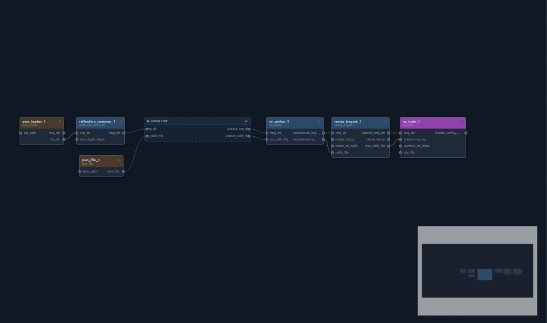

The window has five areas:

| Area | Purpose |
|---|---|
| **Toolbar** (top) | Run / debug / stop the pipeline, reset states, clear cache |
| **Components** (left) | All installed node types, grouped by category |
| **Canvas** (center) | The graph: nodes, wires, groups; minimap bottom-right |
| **Properties** (right) | Everything about the selected node: inputs, color, run buttons, cache |
| **Terminal** (bottom) | Live logs, progress bars, and system stats |

### 3.1 Adding nodes

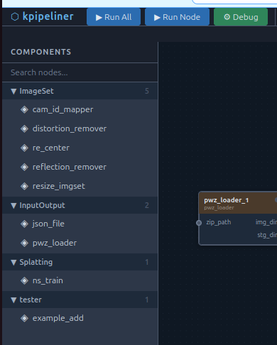

Three ways to add a node:

- **Drag & drop** a type from the Components panel onto the canvas — the node is created where you drop it.
- **Click** a type in the Components panel — the node is placed on the canvas.
- **Right-click** an empty spot on the canvas → *Add Node* → pick a category and type. The node appears where you clicked.

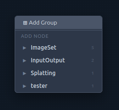 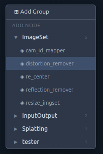

The search box at the top of the Components panel filters types by name or description:

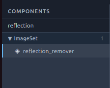

### 3.2 Connecting nodes

Every node shows its **inputs on the left** and **outputs on the right** as small circular handles (filled = connected, hollow = free). To connect two nodes, drag from an output handle to an input handle. To disconnect, select the wire and press `Delete`.

Wires are exactly the `nodes.X.Y` references from the CLI world — the GUI and `graph_config.yaml` stay in sync at all times, so a graph built in the GUI runs identically with `kpl run`.

**Selecting a wire** — click the wire itself, or click either of its handles (the small dot at each end) — opens it in the Properties panel with two controls: a **Handle Color** picker and a **Hide link** checkbox. Clicking the same handle again deselects. Jump links (§3.8) and group links (§4.3 — outside→group input, group input→node, node→group output, group output→outside, and group→group) support the same controls; a hidden group link leaves its port dot ringed, clickable to reselect it.

A handle with more than one wire on it (an output feeding several nodes, or a jump-in fed by several) is genuinely **one shared point** — clicking it selects *every* wire attached, and the Properties panel shows them as a group: one **Handle Color** picker that recolors all of them at once (that's what "Handle Color" means for a shared handle — there's only one dot to color, however many wires touch it), and one **Hide all N** checkbox that shows/hides them together. Handle Color is genuinely shared this way; **hide is still stored per-wire underneath** — the group checkbox is just a convenient way to set it on all of them in one click, not a change to how each wire's visibility is tracked. To hide only one wire out of several, select it individually (click its own curve rather than the shared handle) and use its own Hide checkbox.

Hiding a wire keeps its handles visible and highlighted (still clickable, so you can find and reselect a hidden wire later) — only the connecting line itself disappears.

### 3.3 The Properties panel

Select a node to edit it:

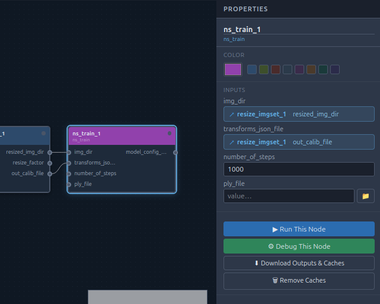

- **Name** — click the title and type a new one. Renaming automatically rewrites all wires and references that point to the node.

  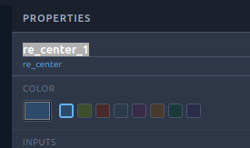

- **Color** — pick one of the preset swatches, or click the color field for a full palette with custom colors. Colors are purely visual, useful to mark stages of a large pipeline.

  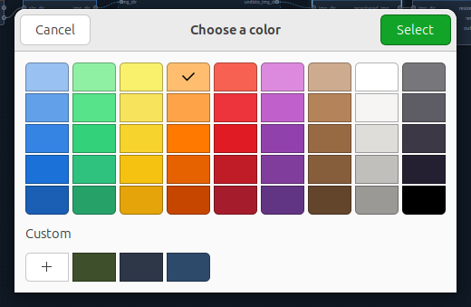

- **Inputs** — each input is either an editable value field or, when connected, a **connection chip** showing which node/output feeds it:

  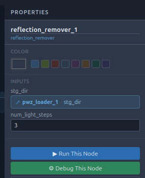

- **FILE inputs** get a 📁 browse button that opens a file picker over the pipeline's `data/` directory. You can also **upload** files from your machine into `data/` directly from this dialog (with a progress bar) — the uploaded file is selected automatically.

  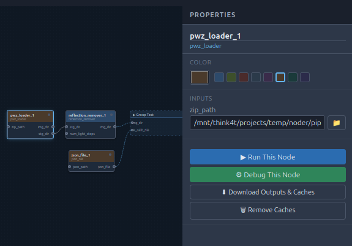

- **Run buttons** — *Run This Node* / *Debug This Node* run only this node (plus its dependencies).
- **⬇ Download Outputs & Caches** — downloads the node's cache directory as a ZIP (handy when the server runs on another machine).
- **🗑 Remove Caches** — deletes this node's cached results (after confirmation).
- **🔒 Freeze Cache / 🔓 Unfreeze Cache** — toggles whether this node is protected from *Clear Cache* / `kpl clean` (§2, Step 7). A frozen node shows a small 🔒 badge on its title bar on the canvas. The same toggle is available by right-clicking the node → *🔒 Freeze cache* / *🔓 Unfreeze cache*. This is the GUI equivalent of listing the node under `frozen_nodes:` in `graph_config.yaml` — both stay in sync automatically.

### 3.4 Running the pipeline


- **▶ Run All** — runs the pipeline's declared outputs (§3.6) and their dependencies in parallel, respecting the cache; nothing runs if no output is marked.
- **▶ Run Node** — appears when a node is selected; runs just that node and its dependencies.
- **⚙ Debug** — like Run, but streams the nodes' full output to the terminal panel.
- **■ Stop** — aborts the current run (enabled only while running):

  

- **↺ Reset** — resets all node state colors back to default.
- **⊗ Clear Cache** — clears the cache of all non-frozen nodes.

When you run a single node that already has cached results, the GUI asks whether to clear its cache first (i.e. recompute) or reuse it:

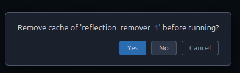

While running, node colors on the canvas (and in the minimap) follow the execution state — green while running, blue when completed, red on failure.

### 3.5 Terminal & monitoring

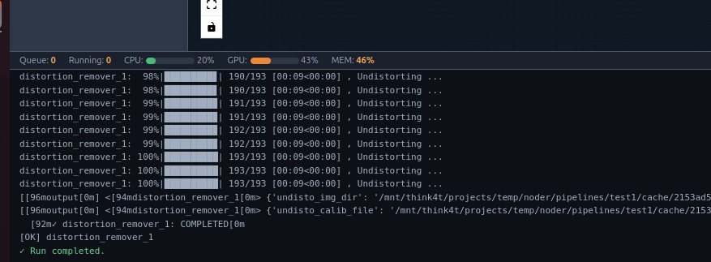

The bottom panel shows live per-node progress bars, log lines (color-coded: info, warning, error, output), and the final run result. The status strip shows the run queue and system load:


- **Queue** — nodes waiting to run · **Running** — nodes currently executing
- **CPU / GPU / MEM** — live utilization of the machine running the server

The GUI also notices pipeline runs started **outside** of it: if you execute `kpl run` in a terminal in the same directory, the node currently running there is highlighted on the canvas with a pulsing glow. This also works for `kpl run --kwui`: while a UI step runs a group (a nested run), the step AND the node of the group that is running right now glow at the same time. This is purely informational — the GUI does not switch into "running" mode and you can still start your own runs from it.

### 3.6 Marking pipeline inputs & outputs

A pipeline can declare which of its nodes are its **inputs** (where data enters) and **outputs** (where the results come out). Right-click a node and choose **Add to inputs list** or **Add to outputs list** (the same entry removes the mark again).

- Input nodes show a **brown** title bar, output nodes a **green** one (a node that is both shows brown/green split).
- The marks are stored in `graph_config.yaml` as the top-level `inputs:` / `outputs:` name lists. `inputs:` is purely descriptive. `outputs:` is NOT: it's what "▶ Run All" (and `kpl run` with no node) actually runs — those nodes plus whatever they depend on, nothing else. A pipeline with no output marked won't run anything from "▶ Run All" / `kpl run`.

### 3.7 Editing shortcuts

| Action | How |
|---|---|
| Undo / Redo | `Ctrl+Z` / `Ctrl+Shift+Z` |
| Delete node or wire | select it, press `Delete` |
| Duplicate node | right-click node → *⧉ Duplicate* |
| Run one node | right-click node → *▶ Run this node* |
| Freeze / unfreeze a node's cache | right-click node → *🔒/🔓 Freeze/Unfreeze cache*, or the button in the Properties panel |
| Node context actions | right-click a node |
| Pan / zoom | drag empty canvas / mouse wheel (controls bottom-left) |

Nodes snap to the background grid; the grid pattern and snap behavior are configured in the pipeliner's `config.yaml` (see [Reference](#6-reference)).

### 3.8 Jump links (execution order without data)

Sometimes one node needs to run after another even though nothing it produces is
actually used — there's no `nodes.X.Y` reference to draw. A **jump link** is a
connection that carries no data at all; it only says "run this node after that
one."

Jump ports aren't shown all the time like regular inputs/outputs — they appear
only when you need them:

- **Hover any node** and a small amber diamond handle appears at the right edge
  of its title bar, at the same x position as a regular output port — the
  **jump-out** port.
- **Drag from it** toward another node; while dragging, whichever node you hover
  reveals its own diamond handle at its left edge, same x as a regular input
  port — the **jump-in** port. Drop the wire there to connect.
- The resulting wire is drawn as a dashed violet line, distinct from ordinary
  data wires. It's selectable/deletable just like any other wire, and supports
  the same Handle Color / Hide link controls in the Properties panel (§3.2).
- A node's **jump-in accepts multiple** incoming jump wires — it then waits for
  *all* of them to finish, not just one. A node's **jump-out feeds only one**
  target, though — wiring a new one replaces whichever it already had.
- Jump wires only connect to other jump ports, never to a regular input/output,
  and a node can't jump-link to itself.
- When a node with a jump-out finishes running, it automatically continues on
  and runs whatever it's jump-linked to — it's a chained "then run this" step,
  not just an ordering constraint you have to trigger from the other end.

Under the hood this is stored as a top-level `jump_links:` list in
`graph_config.yaml` (see [Reference](#6-reference)) — it's independent of every
node's declared inputs/outputs, so it works with any node type without changes.
For a full pipeline run ("Run All" / `kpl run` with no node given), a
jump-dependent node participates in the normal dependency graph: it's skipped
if its jump predecessor fails, exactly like a real data dependency. Running a
single node directly ("Run" on that node / `kpl run <node>`) also chases its
jump predecessor(s) first — but only if one hasn't completed before (the same
"does it have a cached result" check the Properties panel/`kpl status` use);
an already-finished predecessor is left alone rather than re-run, and
"Clear Cache" (or `--no-use-cache` on the CLI) forces it to run again like any
other dependency. The jump-out side effect also still fires forward on its own
once a node finishes (for any reason) — so a chain keeps going however you
enter it, either end.

A jump wire with one end inside a folded group is hidden while folded (it
reappears on unfold) — but a jump wire that actually *crosses* a group's
boundary routes through the group's own jump ports, same as a data wire
routes through `gin-`/`gout-` ports; see §4.3.

---

## 4. Groups & Reusable Components

Groups keep large pipelines organized: they bundle related nodes into a labeled box that can be collapsed to a single node — and exported for reuse in other pipelines.

### 4.1 Creating a group

Right-click an empty spot on the canvas → **⊞ Add Group**. An empty group box appears; drag it anywhere and resize it by its corners.

- **Add nodes** to the group by dragging them inside the box. They move with the group from then on.
- **Remove a node** by dragging it out, or right-click → *⊠ Remove from group*.
- **Rename** the group by clicking its title. With the group selected, the Properties panel also offers a **description** field (shown as a tooltip on the group header).
- **Delete a group** the same way as a node — select it and press `Delete`, or right-click → *✕ Delete node*. Since this removes every node inside it too, you're asked to confirm first; canceling leaves the group untouched.

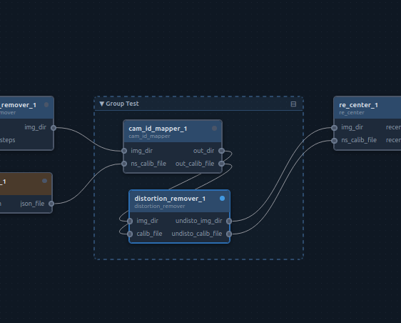

### 4.2 Folded view

Click the ⊟ symbol in the group header (or toggle **Folder view** in the Properties panel) to collapse the group into a single compact node. All internal nodes and wires are hidden; connections crossing the group boundary are shown on the folded box:

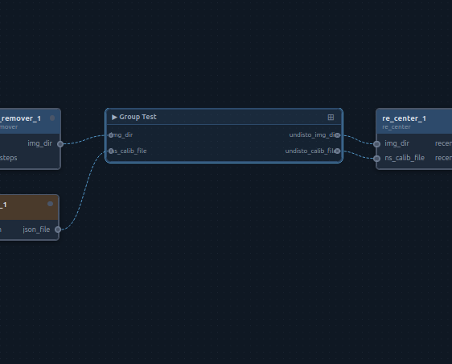

This is purely visual — folding changes nothing about execution.

### 4.3 Group ports (defined inputs & outputs)

By default, a group simply shows every wire that crosses its border. For a clean, reusable interface you can define explicit **group inputs and outputs** (shown in amber):

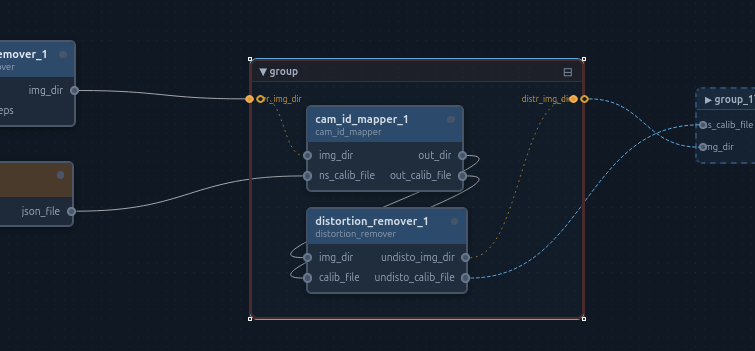

With the group selected, use the Properties panel to add, rename or delete ports:

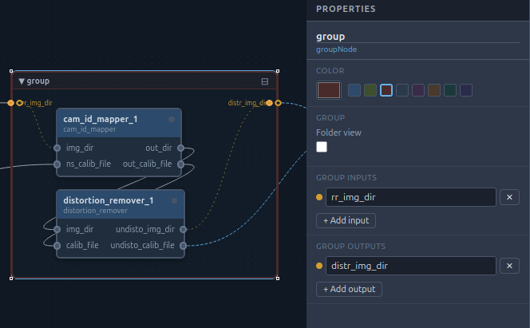

A port works like a small router with a fixed direction:

- a **group input** (`gin`) receives a wire from *outside* the group and feeds nodes *inside* it,
- a **group output** (`gout`) receives a wire from *inside* the group and feeds nodes *outside* it.

Inner port connections are drawn dotted in the port color. On save, port chains are resolved to plain `nodes.X.Y` references — the executor doesn't know about groups at all, so grouped pipelines run identically from the CLI.

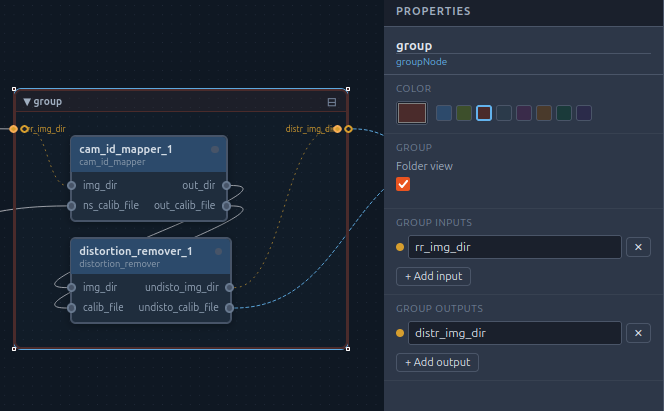

**Jump routing (§3.8) works the same way.** A group also has a fixed pair of
jump ports — one `jump-in`, one `jump-out`, hover-revealed on the group's
title bar just like a node's own jump handles. A jump wire from an outside
node lands on the group's `jump-in`; from there, a second wire inside the
group continues it to a specific child's own jump-in (symmetric for
`jump-out`, collecting from a child and continuing outward). Like data
ports, this is resolved on save into a plain node-to-node `jump_links` entry
— the executor never sees the group.

**Running a group:** with the group selected, the Properties panel has a **▶ Run This Group** button. It does the same as `self.groups['x'].run()` in node code and `kpl group run <id>` on the CLI: it runs whatever feeds the group's declared outputs, reusing cached results for their upstream dependencies. Only that chain runs: nodes that merely come *after* the group's output nodes through a jump link are not triggered (unlike `kpl run <node>`, which follows jump links onward). A group without any wired-up output has nothing to run — the terminal says so.

**Removing a group's caches:** with the group selected, the Properties panel has a **🗑 Remove Caches** button that deletes the cache of every node inside it (nested groups included). Frozen nodes keep their cache — same rule as `kpl group clean`.

### 4.4 Exporting a group as a reusable component

A group with defined ports can be exported as a **component** and reused in any pipeline:

1. Select the group.
2. In the Properties panel, under **Export as Component**, choose a category (or type a new one).
3. Click **⬆ Export Group**.

The component (the group with its child nodes, internal wiring and ports) is saved as a template under the pipeline's **`groups_dir`** (set in its `graph_config.yaml`; new pipelines get `groups_dir: groups`) and immediately appears in the Components panel under **groups/&lt;category&gt;**, marked with the ⊞ icon. Exporting to an existing name asks for confirmation before overwriting. A pipeline whose `graph_config.yaml` has no `groups_dir` keeps using the installation-wide `group_base_nodes` folder from `config.yaml` (add the key to switch). The Components panel lists the pipeline's `groups_dir` first and the installation folder after it, so groups exported earlier stay available; on a name clash the pipeline's own group wins.

Dropping a group component onto the canvas expands it into a fresh group with new, collision-free node names — you can then wire its ports and adjust inputs like any other part of the graph. Note: connections to nodes *outside* the group are not part of the template; only the internal structure and the ports are.

### 4.5 Underlying groups — binding a node to a group

A node **type** can declare named group *slots* in its `node_config.yaml` (see
§5's `underlying_groups`) — think of it like declaring an input or output,
except the "value" is a whole group rather than a single value. Every
instance of that node type gets its own copy of these slots, and you bind
each one to an actual group in **this** pipeline.

- **Binding a slot**: select the node. If its type declares any slots, the
  Properties panel shows an **Underlying Groups** section with one dropdown
  per slot, listing every group currently on the canvas (plus "— none —").
  Picking a group binds the slot to it.
- **The chip**: once bound, the group's name appears as a small chip under
  the node, in that group's own color. Clicking the chip **enables and
  highlights** the group (so you can see which group is currently "active"
  for that node); clicking it again — or clicking anywhere else on the
  canvas — disables it. Only one bound slot per node can be enabled at a
  time. A disabled group is shown hatched; clicking a hatched group highlights
  its owning node (an orange outline; your selection does not move), so you can
  always find the way back to it. The highlight goes away at the next click elsewhere.
- **Unbinding**: set the dropdown back to "— none —". If nothing else in the
  pipeline still references that group, it reverts to a perfectly normal,
  unmanaged group — no hatching, no special state.
- **Auto-instantiating a slot's group**: a slot can additionally declare an
  `address` — the category/name of an exported group **component** (§4.4).
  When you create a node with such a slot, kpipeliner looks for a component
  at that address: if found, it's expanded onto the canvas automatically and
  the slot is bound to it right away; if not found, you're asked whether to
  create the node anyway (slot left unbound) or cancel creating it. A slot
  with no `address` is simply created empty, as above.
- Binding is per **node instance**, saved in `graph_config.yaml` next to that
  node's `inputs:`/`outputs:` — it has no effect on execution by itself (the
  executor doesn't know about groups). It only matters once the node's own
  code reaches into the group, described next.

---

## 5. Creating a Custom Node

A node type is just a directory with two files:

```
my_node/
├── node_config.yaml   # metadata: inputs, outputs, category, environment
└── node.py            # the logic: a class with a run() method
```

### Step 1 — Create the template

```bash
mkdir my_node && cd my_node
kpl base_node create
```

This copies a ready-to-edit `node_config.yaml` and `node.py` into the current directory.

### Step 2 — Declare the interface (`node_config.yaml`)

```yaml
author: "Your Name"
date: "2026-07-16"
version: "1.0"
description: "Describe what this node does."   # shown in kpl list and the GUI
category: "General"                            # category in the Components panel

inputs:
  - name: input_file
    type: FILE          # STRING | INT | FLOAT | BOOL | FILE | DIR
    default: ""
    description: "What this input is for."
  - name: count
    type: INT
    default: 10

outputs:
  - name: result
    type: STRING
  - name: out_dir
    type: DIR
```

Notes:

- **Types** matter in the GUI: `FILE` inputs get the 📁 data-browser button; all types are shown as documentation.
- **Defaults** are what a freshly added node starts with.
- **`category`** decides where the node appears in the Components panel and under which folder it is installed.

If your node needs its own Python packages, declare an environment (see Step 5):

```yaml
python_environment:
  env_manager: venv        # null | venv | conda | pixi
  env_directory: .venv
  requirements: requirements.txt
```

If your node should drive a whole group as a subroutine (§4.5, §9), declare
its slot(s):

```yaml
underlying_groups:
  - name: calibration       # referenced in node.py as self.groups['calibration']
    description: "Group that produces the calibration file this node needs."
    address: precalibration/camera_setup   # optional: category/name of a group
                                            # component to auto-instantiate
```

### Step 3 — Write the logic (`node.py`)

```python
import os
import shutil
import sys

# If kpl (kpipeliner) is installed, this import will work directly.
sys.path.append(os.path.dirname(shutil.which("kpl") or shutil.which("kpipeliner")))

from kpipeline import KNode


class KapNode(KNode):

    def run(self):
        # 1. Read inputs (as declared in node_config.yaml)
        input_file = self.inputs['input_file'].value
        count = self.inputs['count'].value

        self.log(f"Processing {input_file} ({count}x)")
        self.send_status_message("RUNNING", progress=0, max=count, message="Starting...")

        # 2. Do the work — write files into self.output_dir
        result_path = os.path.join(self.output_dir, "result.txt")
        for i in range(int(count)):
            # ... your processing here ...
            self.send_status_message("RUNNING", progress=i + 1, max=count, message=f"step {i + 1}")

        # 3. Save outputs (as declared in node_config.yaml)
        self.save_output("result", result_path)
        self.save_output("out_dir", self.output_dir)

        self.send_status_message("COMPLETED", message="Node finished.")


if __name__ == "__main__":
    KapNode(arg_parser=True)
```

The `KNode` base class gives you:

| Attribute / method | Purpose |
|---|---|
| `self.inputs['name'].value` | Read an input value (references are already resolved to concrete values when your node runs) |
| `self.output_dir` | This node's cache directory (`cache/<uuid>/<node_name>/`) — write all result files here |
| `self.data_dir` | The pipeline's shared `data/` directory |
| `self.name`, `self.uuid` | Node instance name and pipeline UUID |
| `self.save_output(name, value)` | Persist an output value — this is what downstream nodes receive |
| `self.save_image(name, image)` | Convenience: save a numpy image (via cv2) into the output dir and register the path as output |
| `self.log(msg, level=...)` | Log line in the terminal / GUI AND the log file (`debug`, `info`, `warning`, `error`) |
| `self.send_status_message("RUNNING", progress, max, message)` | Drives the progress bars in CLI and GUI, and is recorded in the log file |
| `self.make_dir("subdir")` | Create a subdirectory inside `output_dir` |

Two rules of thumb:

- **Always** write result files into `self.output_dir` and register them with `save_output()` — that is the caching contract.
- Report progress with `send_status_message()` for anything long-running, so users see live feedback.

### Per-node file logging

Every node run writes its log to `output_dir/log/run.log` (i.e.
`cache/<uuid>/<node_name>/log/run.log`), appended across runs. `self.log(msg, level=...)` and any
plain `print(...)` in your node's code both go there — a bare `print()` is logged as `info`.

Verbosity is controlled **pipeline-wide** (not per node) via two `graph_config.yaml` keys:

```yaml
log_level: INFO       # DEBUG | INFO | OUTPUT | WARNING | ERROR — the debug level is hidden
                       # unless set explicitly; everything else is shown by default
log_enabled: true      # false turns file logging off entirely (self.log() still prints as before)
```

A node that raises an uncaught exception gets its traceback logged once (`error` level, both to
the file and the terminal/GUI) before it exits non-zero — no need to `self.log()` it yourself.

Because of `arg_parser=True`, the node is also a standalone CLI program — you can test it directly:

```bash
python node.py --node_id test_1 --input_file data/x.txt --count 3
```

### Step 4 — Install the node type

From inside the node directory:

```bash
kpl base_node install                      # installs under the directory's name
kpl base_node install --node_name my_node  # or with an explicit name
```

This copies the directory into the configured default base-nodes directory, making the type available to `kpl list`, `kpl add` and the GUI (reload the browser page to refresh the Components panel). To place it in a specific category, either set `category:` in the config or move the installed folder into the matching category subdirectory.

Alternatively, a node type can stay where it is: add its parent directory to `custom_base_nodes_dirs` in a pipeline's `graph_config.yaml` and it becomes available to that pipeline without installing (see [Reference](#6-reference)).

Re-running `install` after changes asks before overwriting the installed copy. To remove a type:

```bash
kpl base_node uninstall my_node
```

### Step 5 — Node environment (optional)

If the node declared a `python_environment`, install it once per machine:

```bash
kpl node_env install --node_type my_node
```

For `venv` environments this creates `.venv/` inside the node directory and installs its `requirements.txt` automatically. `conda` and `pixi` environments must currently be set up manually at the declared `env_directory`. When the node runs, kpipeliner uses that environment's Python — so every node can have its own, mutually incompatible dependencies.

If a node declares **no** environment (`env_manager: null` or no `python_environment` section), it runs with the same Python `kpl` itself is running under — the venv configured at install time (`./install.sh --venv`, `config.yaml`'s `python_env`) if one is set, otherwise the default python environment `kpl` was invoked with — not whatever Python happens to be active in your shell at that specific moment.

### Step 6 — Use it

```bash
cd /path/to/some/pipeline
kpl add my_node
kpl run my_node_1
```

…or drag it from the Components panel in the GUI.

---

## 6. Reference

### CLI commands

| Command | Description |
|---|---|
| `kpl init` | Initialize a pipeline in the current directory |
| `kpl gui` | Launch the web GUI for the current directory |
| `kpl gui --mcp` | Launch the GUI with an MCP endpoint also mounted at `/mcp` |
| `kpl mcp` | Headless MCP server for the current directory — no GUI/REST API at all, see §7 |
| `kpl list` | List installed node types by category |
| `kpl add <type> [<name>]` | Add a node instance to the graph |
| `kpl run [<node>] [--params k v ...]` | Run the declared outputs + deps, or one node incl. dependencies |
| `kpl run --no-use-cache` | Recompute instead of reusing cached results |
| `kpl run --no-parallel` | Run nodes sequentially |
| `kpl run_debug [<node>]` | Run with full log output |
| `kpl kwui init` | Create `workflow.py` for the kwebui workflow UI (see §8) |
| `kpl kwui design <node_type>` | Design a node's UI page visually (kwebui edit mode, see §8.6) |
| `kpl run --kwui` / `kpl run_debug --kwui` | Run sequentially behind that workflow UI |
| `kpl run --kwui --kwui-host H --kwui-port P` | Serve that UI elsewhere (`--kwui-no-browser` to not open a tab) |
| `kpl tree` | Print the graph with dependencies and inputs/outputs |
| `kpl status` | Show cached / frozen state per node |
| `kpl clean [<node>]` | Clear cache (all non-frozen nodes, or one node) |
| `kpl node_env install [--node_type T]` | Install node Python environments |
| `kpl base_node create` | Create a node template in the current directory |
| `kpl base_node install [--node_name N]` | Install the current directory as a node type |
| `kpl base_node uninstall <name>` | Remove an installed node type |
| `kpl uninstall` | Remove kpl from your PATH |

### `graph_config.yaml` (per pipeline)

```yaml
name: "my_pipeline"
description: "..."
execution:
  cpu_workers: 2        # parallel CPU nodes
  gpu_workers: 1        # parallel GPU nodes
available_nodes: []     # optionally restrict node types offered in the GUI
frozen_nodes: []        # nodes whose cache is never cleared

# Base-node sources for this pipeline:
load_default_base_nodes_dir: true   # include the installation-wide default dir
custom_base_nodes_dirs: []          # extra dirs with node types (absolute, or
                                    # relative to the pipeline dir); scanned
                                    # before the default — a custom type with
                                    # the same name wins
groups_dir: groups                  # where groups exported from the GUI are saved (and read
                                    # first); absolute, or relative to the pipeline dir.
                                    # Without it: the installation's group_base_nodes folder

cache_dir: cache        # where node outputs live; relative to the pipeline
                        # dir, or absolute (starts with '/') to store cache
                        # elsewhere
data_dir: data          # where shared input data lives; relative or absolute,
                        # same rule as cache_dir

log_level: INFO         # DEBUG | INFO | OUTPUT | WARNING | ERROR — every node's self.log()/
                        # print() in this pipeline (not per node); file at
                        # cache/<uuid>/<node>/log/run.log, appended across runs
log_enabled: true       # false disables file logging entirely

inputs: []              # node names marked as pipeline inputs (brown in GUI); metadata only
outputs: []             # node names marked as pipeline outputs (green in GUI); ALSO scopes
                        # `kpl run`/`run_debug` with no node arg (and GUI "Run All") to just
                        # these nodes + their deps — empty list means such a run does nothing
jump_links: []          # [{source: node_name, target: node_name}, ...] — optional
                        # execution-order-only edges (see §3.8); target runs after
                        # source, no data exchanged, can have several per target
nodes: [...]            # managed by kpl add / the GUI
```

### `config.yaml` (pipeliner installation, applies to all pipelines)

```yaml
default_base_nodes_dir: base_nodes     # default dir for installed node types (relative to this
                                        # file's folder, or absolute)
group_base_nodes: group_base_nodes      # fallback folder for exported groups of pipelines without a `groups_dir`
lazy_input_resolution: true
kwui: {host: 0.0.0.0, port: 8701, open_browser: true}
gui:
  background:
    pattern: dots    # dots | lines | cross | none
    gap: 10          # grid distance = snap grid
    size: 1
    color: '#2d3748'
  snap:
    enabled: true
```

### GUI server

```bash
python kpipeline_gui/server.py --workdir <pipeline_dir> [--host 0.0.0.0] [--port 8601] [--no-browser]
```

`kpl gui` is the normal way to start it; the options above are for running it manually (e.g. headless on a server). If the port is taken, the next free one (8602, 8603, …) is used.

---

## 7. MCP (LLM-driven pipeline design)

kpipeliner can expose an [MCP](https://modelcontextprotocol.io) (Model Context Protocol) endpoint so an LLM client can inspect, design, and run the pipeline in the current directory — add/remove nodes, wire connections, set parameters, run the pipeline, and create or edit node types local to this pipeline.

### Installing it

MCP support is optional and not installed by default — the base package deliberately leaves out the `mcp` package, since most installations (anyone just building/running pipelines, without an LLM client involved) never need it. Add it with the extra:

```bash
uv tool install "kpipeliner[mcp]"       # or: uv pip install "kpipeliner[mcp]" / pip install "kpipeliner[mcp]"
```

Without it, `kpl mcp` prints an install hint and exits; `kpl gui --mcp` prints the same hint and falls back to a plain `kpl gui` (the GUI still launches, just without the MCP endpoint).

### Starting it

```bash
kpl mcp             # headless: no GUI/REST API/static frontend at all — just the MCP endpoint
kpl gui --mcp       # normal GUI + the MCP endpoint together, on the same port
```

`kpl mcp` runs a separate, minimal process (`kpipeline_gui/mcp_server.py`) that only ever builds the MCP tool server — it never touches FastAPI's REST routes, the WebSocket, or the frontend static files, so use it when nobody needs the browser GUI open. `kpl gui --mcp` instead mounts the same tools onto the existing GUI server's `/mcp`, for when you want both at once (same port, default 8601+, auto-bumped if taken).

Either way the endpoint is `http://<host>:<port>/mcp` (streamable-HTTP transport). Point your MCP client at that URL — e.g. add it to Claude Desktop's / Claude Code's MCP server config as a `url`-type server.

### Available tools

| Tool | What it does |
|---|---|
| `init_pipeline` | `kpl init` in the working directory |
| `list_node_types` | Available node types (type, category, inputs, outputs, description) |
| `get_graph` | Current nodes, their inputs/outputs, declared pipeline inputs/outputs |
| `add_node` | Add a node instance (same as `kpl add`) |
| `remove_node` | Remove a node, clearing any dangling references to it |
| `set_node_input` | Set an input to a literal value, or a `nodes.<name>.<output>` reference to connect it to another node's output |
| `set_pipeline_io` | Set the declared pipeline inputs/outputs (`outputs` controls what a no-argument run executes) |
| `run_pipeline` | Run the pipeline or a single node (blocking; returns combined stdout/stderr) |
| `get_status` | Cache/run status per node |
| `get_tree` | Dependency tree |
| `create_node_type` | Create a new node type's `node.py` + `node_config.yaml` from the standard templates, local to this pipeline |
| `read_node_file` | Read a node type's `node.py` or `node_config.yaml` |
| `write_node_file` | Overwrite a node type's `node.py` or `node_config.yaml` |

`write_node_file` only works for node types local to this pipeline (its own `custom_base_nodes_dirs` — see §6's `graph_config.yaml` reference); the shared, installation-wide `default_base_nodes_dir` is read-only through MCP, since other pipelines use it too. Use `create_node_type` to make a pipeline-local node type you can then edit.

---

## 8. kwui mode — a web UI per node

A normal pipeline run shows you a terminal (or the GUI's terminal panel). **kwui
mode** runs the exact same pipeline behind a second web page — its own port —
that shows a step tracker on the left and, on the right, the UI of whichever node
is running right now. A node can put anything there: a preview image, a table, a
form, buttons that wait for your decision before the pipeline moves on.

This needs the `kwebui` package installed in kpipeliner's Python environment.

### 8.1 Set it up (once per pipeline)

```bash
kpl kwui init      # copies workflow.py into the pipeline directory
kpl run --kwui     # runs the pipeline behind the UI (kpl run_debug --kwui also works)
```

A browser opens on the printed URL as soon as the server is up. **The pipeline
waits until a browser is actually connected** — otherwise a fast pipeline would
be finished before you saw anything; the terminal says `Waiting for a browser to
connect ...` while it does.

Two URLs are printed, because the UI listens on all interfaces (like the GUI):

```
Workflow UI → http://localhost:8704
On the network → http://192.168.178.58:8704
```

Use the second one to open the page from another machine (phone, laptop). Note
that kwebui has **no authentication** — anyone who can reach that address can
click the buttons of your run.

Defaults live in kpipeliner's `config.yaml`:

```yaml
kwui:
  host: 0.0.0.0        # 127.0.0.1 = this machine only
  port: 8701           # first free port at or above it is used
  open_browser: true
```

and can be overridden per run: `--kwui-host`, `--kwui-port`, `--kwui-no-browser`.

> **If the page seems to take forever to appear**, check the port in the terminal.
> The server deliberately stays up after a run finishes, so a previous
> `kpl run --kwui` you never stopped still holds 8701 and the new run moves to
> 8702 — a browser tab left open on 8701 then shows the *old* run and nothing
> ever happens. kpl prints a warning line in that case; press CTRL+C in the old
> terminal (or just open the new URL).

`workflow.py` now belongs to your pipeline and you can restyle it freely. Only two
things are required of it: a `workflow_tracker` stored as `self.tracker` (its task
ids are node names) and a `container` stored as `self.app_container` — that
container is what each running node draws into.

### 8.2 The step sequence

The tracker's steps come from the pipeline's **jump-link chain**, not from the
whole graph: it starts at every node marked as a pipeline input (§3.6) and follows
each node's jump-out (§3.8) until a node has none. Since a jump-out feeds only one
target, this is always a straight sequence — which is what makes "the current
step" meaningful.

Only the **UI nodes** of that sequence (nodes whose `node_config.yaml` has
`kwui: true`, §8.3) appear as steps in the tracker. Nodes without a UI still run
in their place in the sequence, just like in a normal run, but they are not
listed in the workflow.

Nodes that are only pulled in as **data dependencies** still run normally, exactly
as with `kpl run <node>`: before a step starts, each of its connected inputs is
either taken from the cache or the node producing it is run first (recursively,
whether or not that node has a UI or sits in the chain). So a UI node always has
its inputs ready before it draws anything. Such a helper node doesn't get its own
step in the tracker — while it runs, the container shows the "Working ..." spinner.

kwui runs are always **sequential** — one node at a time, so `cpu_workers` /
`gpu_workers` don't apply in this mode.

### 8.3 Giving a node a UI

Add one line to the node type's `node_config.yaml`:

```yaml
kwui: true
```

In the GUI such a node is easy to spot: it gets a **cyan ring** and noticeably
**rounder corners** than a normal node (so you can tell even when zoomed out too
far to read the labels), plus a small cyan **`UI` badge** in its title bar. The
same badge appears next to the node type in the components panel on the left, so
you know before you drop it. This marking sits on top of everything else — the
brown/green input/output title bars, your own node color, the run-state border,
and the blue selection ring all still work as before.

Inside `node.py`, `self.ui` is then that node's panel (it's `None` for a node
without the flag). Every kwebui widget is available, and callbacks stay in
`node.py` — the button you create runs *your* method, in your node's own process:

```python
class KapNode(KNode):

    def run(self):
        self.ui.text("Check the detected objects", size=24, bold=True)
        self.ui.image(self.inputs["preview"].value)
        self.status = self.ui.text("waiting for your review...")
        self.ui.button("Looks good", on_click=self.approve)
        self.ui.button("Run this step again", on_click=lambda: self.ui.end("REPEAT"))

        outcome = self.ui.interact()        # pipeline pauses here
        self.save_output("verdict", outcome)

    def approve(self):
        self.status.set_text("approved")    # updates the live page
        self.ui.end("OKAY")
```

| Call | What it does |
|---|---|
| `self.ui.<widget>(...)` | Add a widget. Returns a handle. |
| handle methods | `handle.set_text("x")`, `handle.update(...)`, `handle.highlight("green")`, `handle.hide()`/`show()`, `handle.disable()`/`enable()`, `handle.remove()`, `handle.focus()` — change a widget that's already on screen. Each widget also has its own (`set_value`, `set_checked`, `set_data`, `set_task_status`, `push_frame`, ...). |
| `handle.<widget>(...)` | Put a widget **inside** a layout widget (`container`, `columns`' columns, `sidebar`, `topbar`, `empty`). Returns the child's own handle, which stays usable afterwards. |
| `self.ui.clear()` | Remove everything this node has added. |
| `self.ui.interact()` | Wait for the user. Returns exactly what `end()` was given (any Python object, unchanged). Optional `timeout=<seconds>`; returns `None` if it elapses. |
| `self.ui.end(msg)` | Releases `interact()`, which returns `msg`. `"OKAY"` = done, `"ERROR"` = fail this node (stops the pipeline), `"ERROR_SKIP"` = show an error on this step but carry on with the next one, `"REPEAT"` = run this node again from the start (matched case-insensitively). Any other message — e.g. `self.ui.end("approved")` or `self.ui.end({"choice": 3})` — counts as done and is simply passed back to `interact()`. |
| `self.ui.set_theme(...)`, `.on_shutdown(...)`, `.exit()` | The page itself, rather than a widget on it. |

**Every kwebui widget is available**: `text`, `button`, `checkbox`, `textedit`,
`slider`, `listbox`, `progressbar` (a.k.a. `progress`), `spinner`, `image`,
`imagestream`, `file_uploader`, `html`, `json`, `table`, `empty`, `container`,
`success`/`info`/`warning`/`error`, `badge`, `toast`, `columns`, `sidebar`,
`topbar`, `popup`, `workflow_tracker` — each with all the arguments kwebui
itself accepts. (Widgets added by a future kwebui version work straight away
too; the bridge asks kwebui what exists rather than keeping its own list.)

**Layouts nest.** Put widgets side by side, or group them in a box, and keep
using each handle afterwards:

```python
left, right = self.ui.columns(2)               # or columns([0.3, 0.7]) for widths
left.image(self.inputs["preview"].value, width=320)
right.table(results)                           # a pandas-like DataFrame works too

box = self.ui.container(caption="Status", direction="horizontal")
label = box.text("checking ...")
box.button("Skip", on_click=self.skip)
label.set_text("ready")                        # the child handle still works

with self.ui.spinner("Crunching numbers...", show_time=True):
    heavy_computation()                        # shows a live elapsed timer
```

**Files and images.** `self.ui.file_uploader("Pick a file", on_upload=self.got_file)`
calls your method with `(filename, data)` where `data` is the file's real bytes.
For live video, create an `imagestream` and call `stream.push_frame(jpeg_bytes)`
from a background thread in your node.

A node that never calls `interact()` simply runs through, exactly as in a normal
run — nothing pauses by itself. While a node **without** `kwui: true` runs, the
container shows a "Working ..." spinner.

### 8.4 Moving around the workflow: history, jumps, Refresh and Reset

**Looking back.** In the workflow's step list (left), click any step that has already
started to see what that node showed — its page comes back, with its buttons switched
off. The running step carries on in the background; click it again to return. This
is on by default; add `history = False` to the `Workflow` class in `workflow.py` to
turn it off (then only the running step is shown, as in older versions).

**Stop on an error, or carry on.** `self.ui.end("ERROR")` marks the step with the error
icon and the workflow stops there and waits (Reset all starts over). `self.ui.end("ERROR_SKIP")`
marks the step with the error icon too, but the workflow moves on to the next step by
itself — use it for a problem that should be visible but must not block the rest. The step
counts as done: save its results before ending, and later steps can use them. If the
node crashes after `end("ERROR_SKIP")` that is a real failure and the workflow stops.

Add a short text under the step icon with a second argument:
`self.ui.end("ERROR_SKIP", "camera not found")` (also for `"ERROR"`). It disappears when the
step runs again or on Reset.

If a node **crashes** without calling `end()`, the workflow stops like for `ERROR`. A node type
can ask to be skipped instead: put `on_error: skip` in its `node_config.yaml` — a crash is then
shown on the step ("crashed (exit code N)") and the workflow goes on. An explicit `end("ERROR")`
still stops it.

**Buttons** in the template's sidebar:

- **Refresh page** — reloads the page in your browser, exactly like pressing F5. It
  does not touch the running node; use it if the page looks out of date.
- **Restart step** — stops the step that is running (and anything it started) and runs it
  again with a fresh page. Earlier steps are not touched. After an error it retries the step
  that failed.
- **Continue** — only available when the workflow stopped because of an error: goes on with
  the next step. The step that failed stays marked as an error, and later steps can still use
  whatever it saved.
- **Reset all** — stops whatever is running (every node, including helper nodes
  without a UI, and anything they started) and starts the whole workflow over from the
  first step.

A node that is in the middle of something — moving hardware, writing a file — is cut
off by Reset all, like with CTRL+C. If a step that already finished left a helper
program running, it is stopped as soon as that step runs again (Reset all, or a jump
back), so you never end up with two copies. When the workflow has finished or stopped on an
error, the page stays open and Reset all starts it again.

**Sending the workflow to another step from node code.** A node can finish and send
the workflow to any other node of the sequence:

```python
self.ui.jump_to("calibrate")            # same as self.ui.end("JUMP", "calibrate")
```

Going back re-runs that step and everything after it; going forward skips the steps in
between (they stay pending). Helper nodes that work from a re-run step are recomputed,
so later steps never see stale data. A name that is not in the sequence fails the node
with a message listing the valid ones. After asking for a jump a node has 5 seconds to
finish what it is doing; if its process is still running then, it is stopped (together
with anything it started) so the workflow can move on. (`self.ui.end("JUMP")` without a name is just
a message, as before.)

### 8.5 Good to know

- The same node works in a normal `kpl run`: with no UI attached, `self.ui` quietly
  does nothing and `interact()` returns `"OKAY"` immediately. You never need two
  versions of a node.
- After the last step, the page stays up so you can look at the final state —
  stop it with CTRL+C in the terminal.
- kwebui 1.0 shows the page in ONE browser tab at a time: opening it in a second tab
  (or from another computer) takes the session over, and the first tab shows
  "superseded" with a Reload button.
- Current limits:
  - **Nothing reads back.** A handle is one-way, so you can't ask a widget for its
    current value (`checkbox.checked`, `imagestream.latest_frame()`). You don't
    need to: the callbacks (`on_change`, `on_select`, `on_upload`, ...) deliver
    every change into your node, so keep the value in your own variable.
  - For the same reason `imagestream`'s `frame_provider=` (where kwebui asks your
    node for each frame) isn't available — push frames instead, with
    `stream.push_frame(jpeg_bytes)`.
  - Widget and callback arguments must be plain data (numbers, strings, lists,
    dicts). Handled for you on top of that: file/image **bytes**, pandas-like
    **DataFrames** for `table`, and your **callbacks**. Anything else — a numpy
    array, a PIL image, a `datetime` — has to be converted in the node first
    (kwebui itself is the same; it does no conversion of its own). For pictures
    that means saving a file and passing its path to `image(...)`, or
    JPEG-encoding to bytes for `imagestream`.

### 8.6 Designing a node's page visually

A node's page does not have to be written in code. With **kwebui 1.0 or newer** (`kpipeliner[kwui]`)
you can lay it out in the browser and let the node load it.

```bash
kpl kwui design <node_type>        # opens the editor on <node folder>/ui.layout.json
```

In the GUI, **right-click a `UI` node → Edit UI** does the same and opens the editor in a new tab
(the entry only appears when kwebui with edit mode is installed). The layout is saved as
`ui.layout.json` in the node type's own folder, next to `node.py`.

In the editor: right-click inside a container to insert a widget, click a widget to change its
properties, drag to move or reorder, drag the gap between two columns to resize. Everything is saved
to the file immediately — there is no save button. Give each widget an **id** (that is the name your
code will use) and, for buttons and other callbacks, type the **name of a method** of your node in the
*Handlers* field.

In `node.py`:

```python
page = self.ui.load_layout()                    # reads ui.layout.json next to node.py
page["title"].update(text="Camera 1")           # use a widget by the id from the editor
page["cols"][1].text("goes into the second column")
self.ui.interact()
```

A callback named in the editor (say `on_save`) simply calls `self.on_save()` of your node. If the file is
missing, a widget type is unknown or a named method does not exist, the node stops with a clear error.
**Showing the UI your code draws (command line only).** Widgets created in code (`self.ui.text(...)`) only exist while
the node runs, so the editor starts empty. `kpl kwui design --show-code --node <name>` runs that node behind the editor:
its coded widgets appear next to the layout, dimmed and not editable — only the layout can be edited. **This executes the
node's real code** (cameras, motors ... up to its `interact()`); no other node is run (cached outputs are used for
inputs). The node stops when you close the designer. The GUI's **Edit UI** never does this.

Two nodes may use the same ids; they never mix up clicks. The page width and theme set in the editor
only apply while designing — the workflow page decides them at run time. The same `node.py` still runs
in a plain `kpl run` (the page calls are ignored there).

## 9. Underlying groups — driving a group from node code

§4.5 covers the GUI side (declaring a slot, binding it to a group, the chip
on the canvas). This section covers the other half: what a node can actually
*do* with a group it's bound to, from inside `run()`.

### 9.1 What it's for

A regular `nodes.X.Y` input reference is implicit — the pipeline's own
dependency graph decides when the upstream node runs, and a node never
controls it directly. An **underlying group** is the opposite: an explicit
relationship a node type declares on purpose, meant to be driven like a
subroutine — stage some inputs, run it, read its results, react to them in
your own logic.

### 9.2 `self.groups['slot_name']`

For every slot declared in `node_config.yaml`'s `underlying_groups`,
`self.groups['slot_name']` gives you a handle with:

| Member | Meaning |
|---|---|
| `.inputs['port'] = value` | Stage a one-off override for one of the group's declared input ports. Only applies to the next `.run()`; **never** written back to `graph_config.yaml` — the pipeline's own saved wiring is untouched. |
| `.run()` | **Blocking.** Runs whatever feeds the group's declared outputs (applying any staged overrides), same as `kpl group run`. Returns `True` on success, `False` on failure. Clears staged overrides afterward either way. |
| `.outputs['port']` | Read one of the group's declared output ports — the value it produced during the last `.run()` (read from cache, so this only makes sense after a successful run). |
| `.remove_cache()` | **Blocking.** Clears the cache of every node in the group (frozen members are skipped), same as `kpl group clean`. Returns `True`/`False`. |

```python
def run(self):
    calib = self.groups['calibration']
    calib.inputs['exposure'] = 120          # one-off override, not saved
    if not calib.run():
        self.log("calibration group failed", "error")
        sys.exit(1)
    calib_file = calib.outputs['calibration_file']
    self.log(f"using calibration from {calib_file}")

    # force a clean recompute next time this node's group dependency runs
    calib.remove_cache()
```

### 9.3 Rules and current limits

- A slot only works if it's **bound** in this pipeline (§4.5) — accessing
  `.inputs`/`.outputs`/`.run()`/`.remove_cache()` on an unbound slot raises a
  clear `RuntimeError` telling you which slot and that it needs binding in
  the Properties panel, rather than a confusing failure deeper in the group.
- `.run()` and `.remove_cache()` are both blocking — there's no background
  execution or separate status to poll, consistent with how `kpl group run`/
  `kpl group clean` already work on the CLI.
- Overrides staged via `.inputs[...]` are always one-off. If you need a
  binding to persist across runs, change it in the Properties panel instead.

### 9.4 Underlying nodes — the same idea for a single node

Sometimes a node needs to run just **one other node**, at a moment of its own
choosing, possibly several times with different inputs (e.g. a measurement node
that moves a turntable, reads the load cell, moves it again). Declare an
`underlying_nodes` slot in the node type's `node_config.yaml`:

```yaml
underlying_nodes:
  - name: table               # referenced in node.py as self.nodes['table']
    description: "Turntable controller this node drives."
    type: table_ctrl          # optional: the node type this slot expects
```

and bind it per node instance. In the GUI this works like the group binding in
§4.5: select the node and use the **Underlying Nodes** section of the Properties
panel — one dropdown per slot, listing the other nodes of the pipeline (only those
of the slot's `type`, if it declares one). Each bound slot shows as a small chip
under the node (`slot → node`, in the bound node's colour).

**Disabled until active — same as a bound group.** A node that is bound to a slot
looks disabled: hatched, and clicking it highlights the node that owns it (the selection stays where it is). Make
it active by clicking its chip under the owner (only one bound node per owner can be
active at a time; click again to switch it off) or by double-clicking the disabled
node. An active node is shown normally with a highlight ring in its own colour. Active
is a temporary focus: clicking the empty canvas, or any node other than the active one
or its owner, switches it off again. It is only about what you see — it is not saved
to `graph_config.yaml` and has no effect on how the pipeline runs.

If you rename the bound node the binding follows; if you delete it, the slot goes
back to unbound. (In `graph_config.yaml` this is
`underlying_nodes: [{name: table, value: table_ctrl_3}]` on that node.)

In `run()`:

```python
table = self.nodes['table']
for angle in (0, 10, 20):
    table.inputs['angle'] = angle       # one-off override, not saved
    if not table.run():                 # blocking; runs it EVERY time you call it
        sys.exit(1)
    weight = table.outputs['weight']    # result of that run
```

How it differs from an ordinary `nodes.X.Y` connection: the bound node is **not**
a dependency of the node that owns it, so a normal run does **not** execute it
beforehand — it runs only when (and as often as) the owner's code says so. Its
jump-link successors are not triggered. `.remove_cache()` clears its cache.

Rules and limits match §9.3: an unbound slot raises a clear `RuntimeError`; a node
that would end up running itself (directly or via a chain) is refused; the nested
run is blocking, is not shown live in the terminal/GUI (see its own
`log/run.log`), and bypasses the cpu/gpu worker limits.
